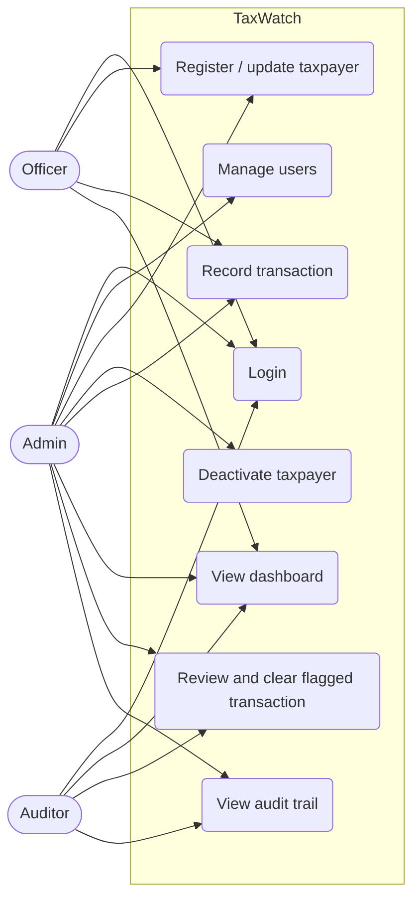
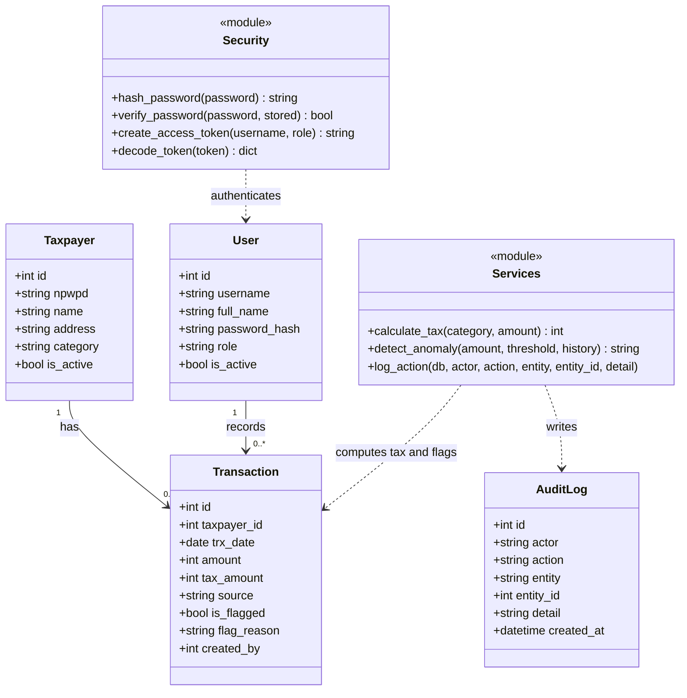
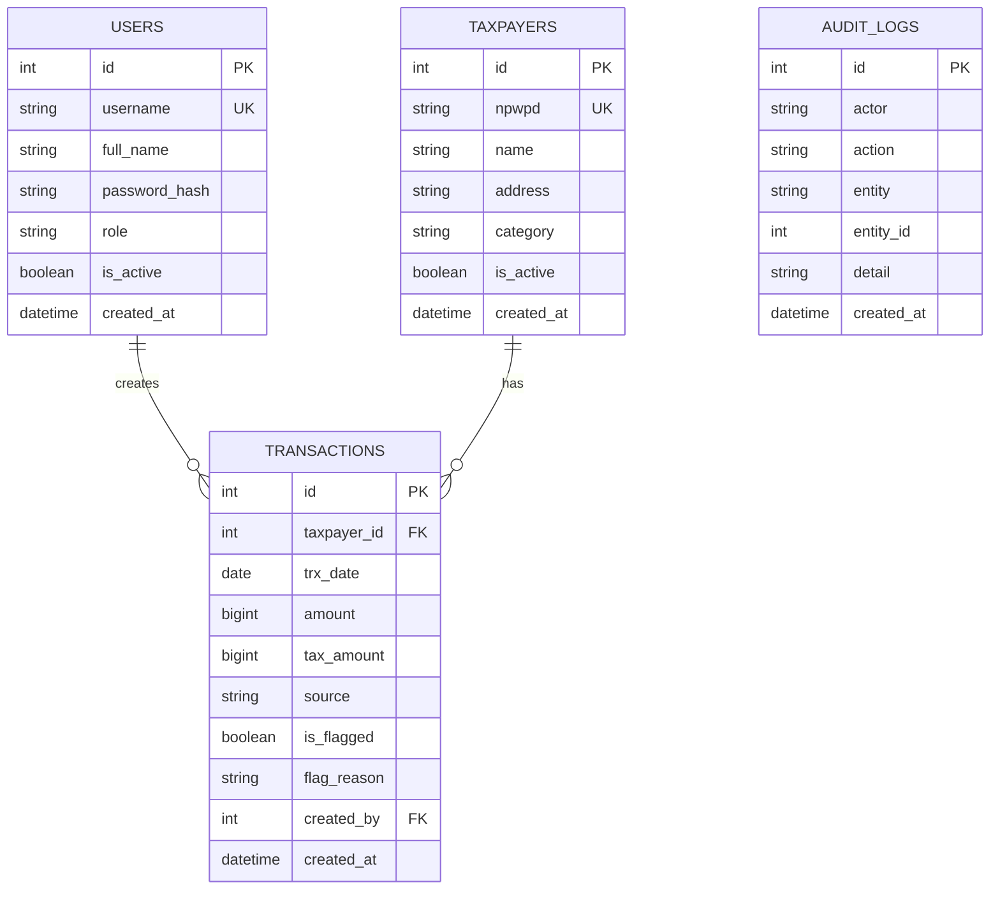
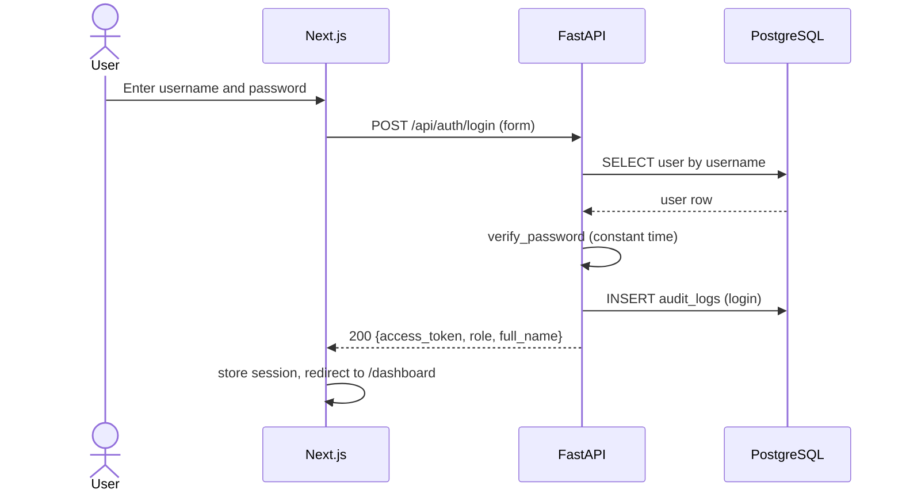
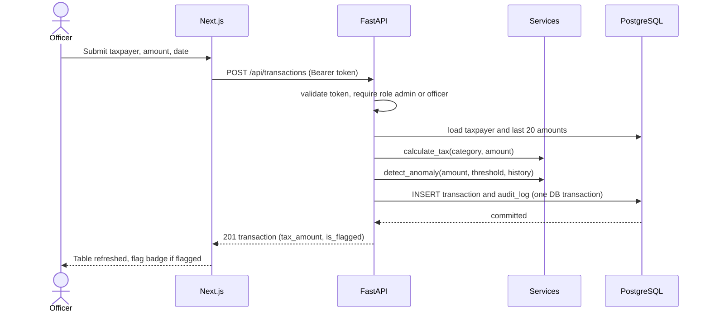
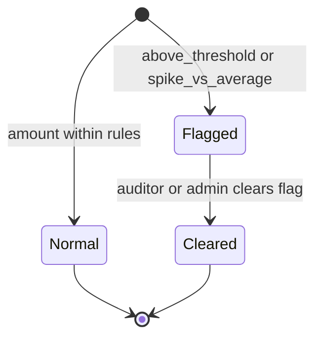
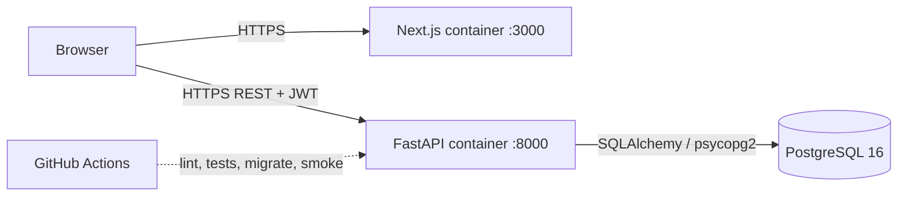

# UML diagrams
Diagrams use [Mermaid](https://mermaid.js.org/) and render natively on GitHub, GitLab and in
PyCharm (Markdown preview with the Mermaid plugin).

## 1. Use case diagram

## 2. Class diagram (domain and business rules)

## 3. Entity-relationship diagram (PostgreSQL)

## 4. Sequence: login

## 5. Sequence: record a transaction

## 6. State diagram: transaction review

## 7. Deployment diagram

